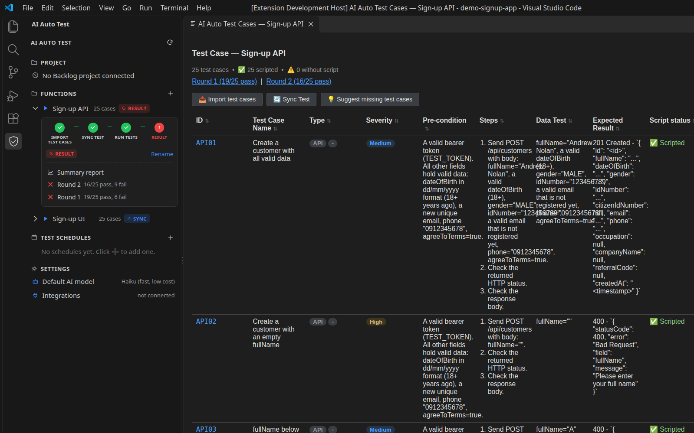
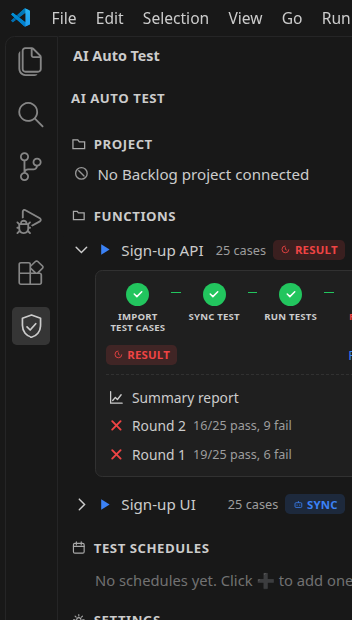
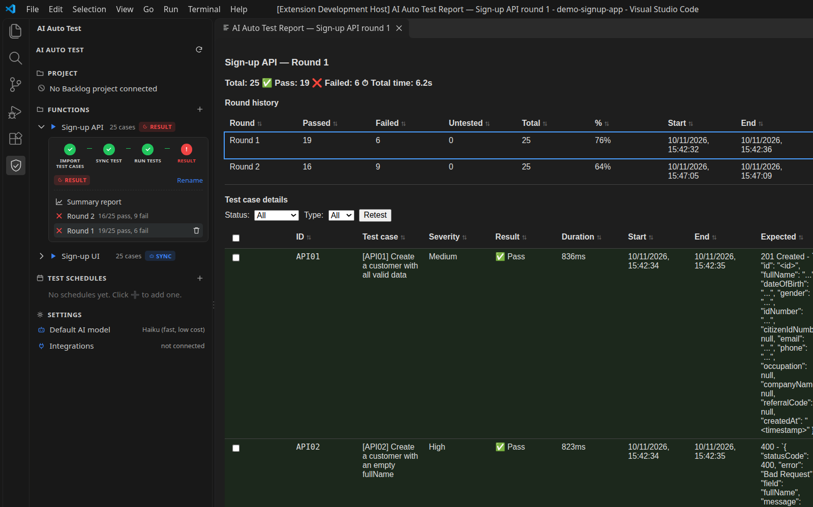
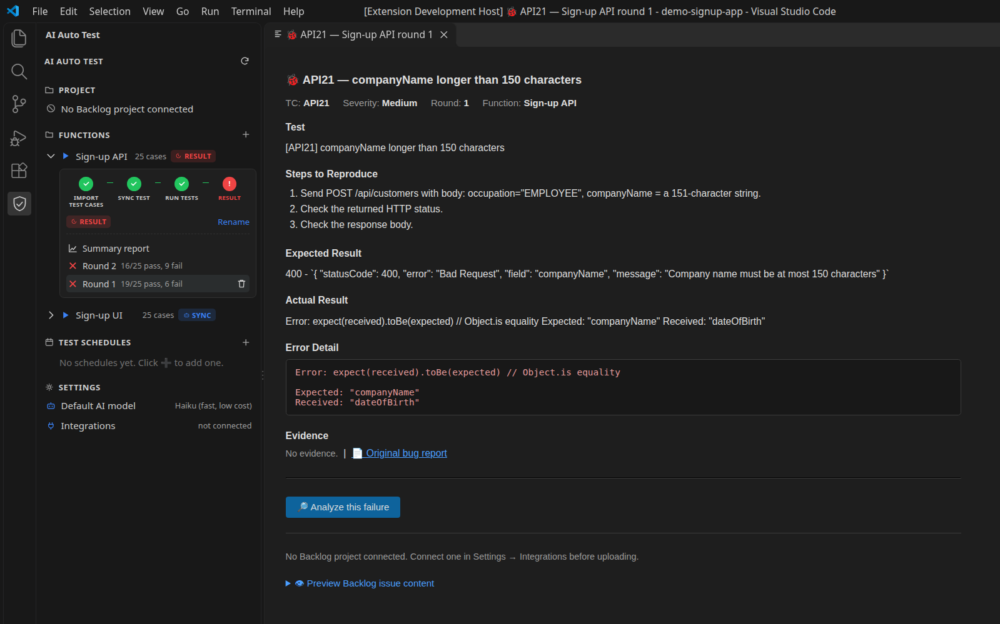
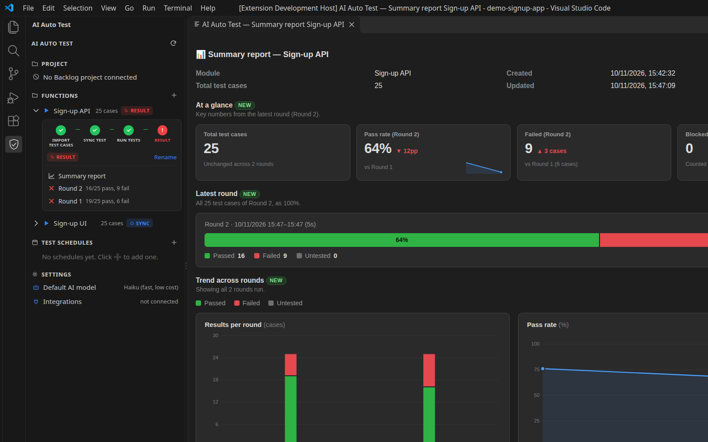

# AI Auto Test

A VS Code extension that turns the test cases your QA team already writes into running Playwright tests.

You import a Markdown table or a multi-sheet Excel file. An LLM (Claude, through the Claude Code CLI) reads each test case, decides whether it can be automated, and writes one Playwright script per automatable case. The extension runs the scripts against your app (UI and API in one run), captures a screenshot as evidence for every case, and, when a case fails, asks the LLM whether the failure is a script bug or an application bug before you file it.

The LLM is only used when scripts are generated. The scripts themselves are plain Playwright code: you can read them, edit them, commit them, and re-run them as often as you like without spending tokens.



## Features

- **Import test cases from Markdown or Excel.** Columns are matched by name (English or Vietnamese headers), so column order and extra columns do not matter. Excel files can have many sheets, title rows above the header, merged ID cells and multi-line cells.
- **Only changed test cases go to the LLM.** Each test case is hashed. Editing one case out of hundreds regenerates one script.
- **Automatable vs. manual.** Cases that need physical actions or human judgement are marked `manual` with a reason instead of getting a fake script.
- **Parallel generation** with a configurable number of `claude -p` processes and batch size. One failed job never discards the others.
- **Live run dashboard** with the Playwright step each test is running, plus Stop / Pause / Resume (pause is POSIX only).
- **Evidence for every case**: the asserted element is outlined in red with the expected result as a label; API cases get a rendered request/response page.
- **Run history** per function, re-run of selected cases, and a summary report across rounds.
- **AI failure analysis**: root cause (script vs. application), fix approach, action items, estimate.
- **Backlog integration** (Nulab Backlog): create or update a bug issue with evidence attached.
- **Suggest missing test cases**: the LLM proposes cases in four groups (functional, non-functional, UI-observable performance, security); you pick which ones to keep, and they are written back to your Markdown or Excel file.
- **Schedules**: run a function once, daily, weekly or monthly (while VS Code is open).

## How it works

```text
Markdown / Excel ──► parse + hash per case ──► changed cases ──► N × `claude -p` jobs
                                                                     │
                     .aitest/functions/<id>/generated/*.spec.ts ◄────┘
                                     │
                     npx playwright test (custom live reporter + evidence helper)
                                     │
                     report · evidence · AI failure analysis · Backlog issue
```

- `src/core/` contains all the logic and does not import `vscode`, so it is unit tested with Vitest.
- `src/webview/` contains the sidebar (a `WebviewView`) and one shared editor panel that every screen renders into.
- `templates/` holds files copied into the project under test: the evidence helper, the live reporter and a Playwright config. The LLM calls these helpers; it never writes them.

## Screenshots

| Sidebar | Round report |
|---|---|
|  |  |

| Failed case | Summary across rounds |
|---|---|
|  |  |

## Requirements

- Node.js 18 or later
- VS Code 1.85 or later
- [Claude Code](https://docs.anthropic.com/en/docs/claude-code) installed and signed in (`claude` works in a terminal). The extension calls `claude -p` and reuses that login; it does not need its own API key.
- Run `claude` once interactively in the project you want to test, to accept the workspace trust prompt.
- Playwright browsers: `npx playwright install chromium`
- The project under test must have `@playwright/test` installed, because tests run with `npx playwright test` in that folder.

## Quick start

```bash
git clone https://github.com/khanhnv1704/auto-test-tool.git
cd auto-test-tool
npm install
npx playwright install chromium
npm test
```

Open the folder in VS Code and press **F5** (configuration "Run AI Auto Test Extension"). In the new Extension Development Host window, open the project you want to test.

To try the whole flow on the bundled demo, see [examples/README.md](examples/README.md): it contains a small sign-up app and the same 50 test cases as a Markdown file and as a multi-sheet Excel file.

1. Click the shield icon in the activity bar.
2. Run **AI Auto Test: Import Test Cases (Markdown / Excel)** and pick a file. For Excel, choose the sheets, then whether each sheet is its own function or all sheets merge into one.
3. In the Test Case panel, fill in the screen URL, API base URL and auth header when asked, then **Sync Test**.
4. **Run Tests**, then open a round to see results and evidence. Click a failed case to analyze it or upload it to Backlog.

## Test case format

Any Markdown table or Excel sheet whose header row contains these columns (case-insensitive):

| Field | Required | Accepted header names |
|---|---|---|
| ID | yes | `Test Case ID`, `TC ID`, `ID`, `Mã test case`, `Mã TC` |
| Name | yes | `Test Case Name`, `Test Case`, `Tên test case`, `Tên testcase`, `Tiêu đề` |
| Steps | yes | `Steps`, `Test Steps`, `Các bước`, `Bước thực hiện` |
| Expected result | yes | `Expected Result`, `Expected`, `Kết quả mong đợi`, `Kết quả mong muốn` |
| Severity | no | `Severity`, `Priority`, `Mức độ`, `Độ ưu tiên` |
| Pre-condition | no | `Pre-condition`, `Precondition`, `Điều kiện tiên quyết`, `Tiền điều kiện` |
| Data test | no | `Data Test`, `Test Data`, `Dữ liệu test`, `Dữ liệu kiểm thử` |
| Kind | no | `Kind`, `Loại test` (`UI` or `API`) |

Rules:

- Other columns (No., Tester, Result, Comment...) are ignored and never sent to the LLM.
- An ID starting with `API` is an API case; anything else is a UI case, unless a Kind column says otherwise.
- A row with an empty ID, or the same ID as the row above (merged cell), continues the case above.
- IDs must be unique within a function. They are the key for change detection, so keep an ID stable when you edit a case.
- Markdown: `# <Function name> - Test Cases` heading, `<br>` for line breaks inside a cell, no `|` inside cells.
- Excel: `.xlsx` or `.xlsm`. The header row is searched in the first 30 rows; cover sheets, history sheets and hidden sheets are skipped. Sheets that look like test case tables but miss a required column are listed with the reason instead of being skipped silently. `.xls` and `.csv` are not supported; save as `.xlsx`.
- A table that matches two or more known headers but misses a required column is rejected with its location. The parser never guesses.

The quality of the generated scripts depends on the content. Name fields exactly as they are labeled on screen, quote the expected messages, and for API cases write the method, path and body.

## Settings

| Setting | Default | Description |
|---|---|---|
| `aitest.generation.model` | `haiku` | Model alias or full model name passed to `claude -p --model`. |
| `aitest.generation.concurrency` | `4` | Generation jobs running at the same time. |
| `aitest.generation.batchSize` | `20` | Test cases per job. Larger batches cost fewer tokens overall. |
| `aitest.execution.workers` | `0` | Playwright workers. `0` = 1 worker when headed. |
| `aitest.execution.slowMoMs` | `300` | Delay between Playwright actions in headed runs. |

## Data written to your project

```text
.aitest/
├── schedules.json
├── backlog.json                    # connected Backlog project (no API key; that is in VS Code SecretStorage)
└── functions/<function>/
    ├── meta.json                   # screen URL, API base URL, auth header, source file, model
    ├── testcases.json
    ├── cache/testcase-hashes.json
    ├── generated/*.spec.ts         # scripts; removed cases move to generated/_stale/
    └── results/round-<n>/          # report.json, live-progress.json, evidence/, bug-reports/
```

Add `.aitest/` to your `.gitignore` if you do not want results in version control. The generated scripts are regular Playwright tests and can be committed.

## Privacy

Test cases, DOM hints, error messages and test case context are sent to Claude through the Claude Code CLI. Do not use the extension on data you are not allowed to send to that service. `meta.json` stores the screen login and the API auth header in plain text; prefer test accounts and test tokens.

## Development

```bash
npm run compile      # tsc → out/
npm test             # vitest (core only; the LLM is mocked)
npm run package      # builds a .vsix with @vscode/vsce
```

## Known limitations

- The AI call has no timeout or cancellation.
- Schedules run only while VS Code is open.
- Pause/Resume during a run is not available on Windows (Stop is).
- Writes under `.aitest/` are not locked; two operations writing the same function at once can conflict.
- Multi-screen end-to-end flows are not covered well yet.
- Generated scripts are not type-checked before the run; errors show up when the test runs.
- Writing suggestions back to Excel rewrites the whole workbook with ExcelJS; a backup is made first, but features ExcelJS does not support (macros, pivot tables, some formatting) may be lost.
- Only the sidebar follows the VS Code color theme; the other panels use a dark palette.

## License

[MIT](LICENSE)
